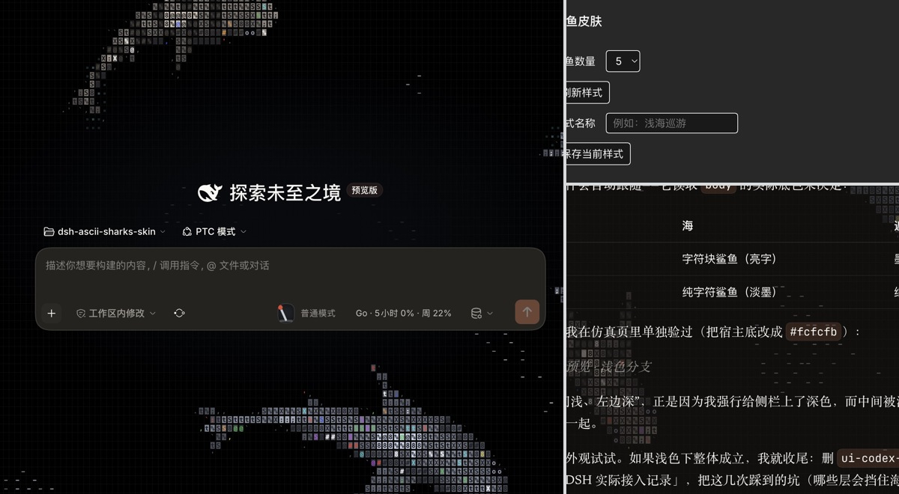

# DSH ASCII 鲨鱼皮肤

让 ASCII 鲨鱼游过 DeepSeek Harness 的聊天窗口。新会话页展示近景鱼群，进入聊天后，鲨鱼可以穿过整片消息区。聊天动画以 34% 不透明度显示，水域止于输入框上沿。皮肤随 DSH 的深浅主题切换。



## 调整与收藏

在 DSH 按 `⌘,` 打开设置，选择「鲨鱼皮肤」。可将数量设为 1–8 条。「刷新样式」会随机组合鱼种、大小和字符材质。输入名称后点「保存当前样式」，以后可以从「已保存样式」选回。命名预设和正在使用的样式保存在当前客户端本地。

## 接入 DSH

插件包位于 [plugin](plugin/)，包名为 `dsh-sharks-skin`，包含已构建的浏览器入口 `lib/client.js`。通过 DSH 的本地插件安装流程选择这个目录。使用 profile 配置时，将包作为本地 link 依赖加入，并将包名加入 `dsh.profile.bundles`。重开 DSH 后，在新会话和已有聊天中均可查看效果。使用 link 安装时请保留插件目录。

## 从源码构建

使用 Node.js 和 npm，从仓库根目录执行：

```sh
cd plugin
npm install --legacy-peer-deps
npm run build
```

DSH 提供运行所需的 React 和 Cordis。页面挂载逻辑在 [entry.js](plugin/src/entry.js)，预设管理在 [settings.js](plugin/src/settings.js)，游动模拟和字符渲染在 [ocean](plugin/src/ocean/)。

鲨鱼引擎基于 [stackedlol/ascii-sharks](https://github.com/stackedlol/ascii-sharks)，随包保留 [MIT 许可证](plugin/LICENSE)。
