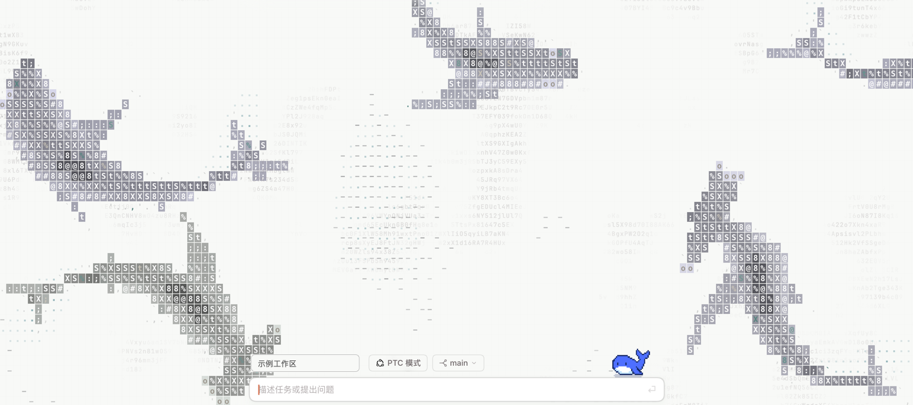
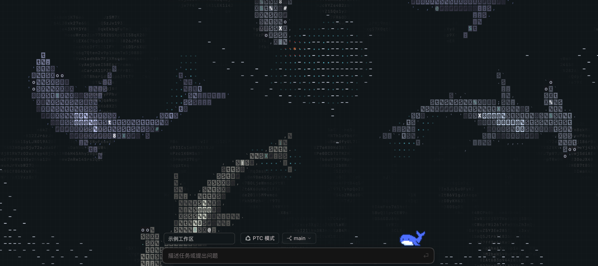

# DSH ASCII 鲨鱼皮肤

让 ASCII 鲨鱼游过 DeepSeek Harness 的聊天窗口。打开新会话，能看见字符拼成的鲨鱼和成群的小鱼。切换 DSH 主题时，水面在纸白和炭黑之间切换。

| 浅色 · 新会话 | 深色 · 新会话 |
| :---: | :---: |
| [](docs/images/new-chat-light.png) | [](docs/images/new-chat-dark.png) |

两图均为实窗局部，工作区名称已替换。点击图片可查看大图。

首页按钮会柔化背后的鱼身字符。进入聊天后，鱼群仍可穿过消息区，两侧动画以 34% 不透明度显示，正文列内约为 12%，水域止于输入框上沿。


## 调整与收藏

在 DSH 按 `⌘,` 打开设置，选择「鲨鱼皮肤」。可将数量设为 1–8 条。「刷新样式」会随机组合鱼种、大小和字符材质。输入名称后点「保存当前样式」，以后可以从「已保存样式」选回。命名预设和正在使用的样式保存在当前客户端本地。

## 接入 DSH

插件包位于 [plugin](plugin/)，包名为 `dsh-sharks-skin`，包含已构建的浏览器入口 `lib/client.js`。通过 DSH 的本地插件安装流程选择这个目录。使用 profile 配置时，将包作为本地 link 依赖加入，并将包名加入 `dsh.profile.bundles`。重开 DSH 后，在新会话和已有聊天中均可查看效果。使用 link 安装时请保留插件目录。

## 从源码构建

使用 Node.js 和 npm，从仓库根目录执行：

```sh
cd plugin
npm install --legacy-peer-deps
npm run build
```

DSH 提供运行所需的 React 和 Cordis。页面挂载逻辑在 [entry.js](plugin/src/entry.js)，预设管理在 [settings.js](plugin/src/settings.js)，游动模拟和字符渲染在 [ocean](plugin/src/ocean/)。

## 原项目 ascii-sharks

[stackedlol/ascii-sharks](https://github.com/stackedlol/ascii-sharks) 是一个无运行时依赖的 Canvas 动画引擎，用 ASCII 字符绘制鱼群和鲨鱼。网页可以把画布交给 `OceanEngine`，指定鲨鱼种类和大小，例如放入一条锤头鲨。原引擎采用 MIT 许可证，本插件随包保留了[上游版权声明和许可文本](plugin/LICENSE)。

本皮肤沿用了原项目的鱼群模拟和字符渲染，并参考了 [dsh-ascii-sharks](https://github.com/cgc1965565186-lab/dsh-ascii-sharks) 的 DSH 接入方式。在 DSH 中，你可以让鲨鱼随界面切换深浅配色，在正文后方淡出，也可以保存自己喜欢的鱼群组合。
